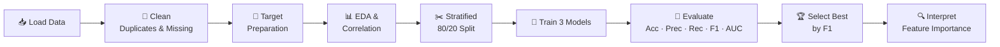

<div align="center">

# ❤️ Heart Disease Prediction using Machine Learning

### An end-to-end binary classification pipeline that predicts heart disease from clinical patient attributes

<p>
  
  
  
  
</p>

<p>
  
  
  
  
  
</p>

[Overview](#-overview) •
[Dataset](https://github.com/aranna05/heart-disease-detection-pipeline/blob/main/heart.csv) •
[Pipeline](#-pipeline) •
[Results](#-results) •
[Getting Started](#-getting-started) •
[Disclaimer](#-disclaimer)

</div>

---

## 📌 Overview

Heart disease is one of the leading causes of death worldwide, and early detection can save lives. This project builds a **supervised binary classification pipeline** that predicts whether a patient has heart disease based on routine clinical measurements such as age, chest pain type, blood pressure, cholesterol, and maximum heart rate.

Three classical machine learning models are trained and compared. The best one is selected using **F1-score**, with particular attention to **recall**, because missing a true positive case is costly in a medical setting.

| | |
|---|---|
| **Task** | Binary classification |
| **Target** | `0` = No heart disease · `1` = Heart disease present |
| **Models compared** | Logistic Regression · K-Nearest Neighbors · Random Forest |
| **Selection metric** | F1-Score |
| **Winner** | 🏆 Random Forest |

---

## 🗂 Dataset

- **Source:** Kaggle — `data855/heart-disease` (Cleveland heart disease data)
- **Samples:** 303 raw → **302** after removing 1 duplicate
- **Features:** 13 clinical attributes
- **Missing values:** None

<details>
<summary><b>📖 Click to view the Data Dictionary</b></summary>

<br>

| # | Feature | Description |
|:-:|---------|-------------|
| 1 | `age` | Age in years |
| 2 | `sex` | Sex of the patient |
| 3 | `cp` | Chest pain type |
| 4 | `trestbps` | Resting blood pressure |
| 5 | `chol` | Serum cholesterol |
| 6 | `fbs` | Fasting blood sugar indicator |
| 7 | `restecg` | Resting ECG result |
| 8 | `thalach` | Maximum heart rate achieved |
| 9 | `exang` | Exercise-induced angina |
| 10 | `oldpeak` | ST depression induced by exercise |
| 11 | `slope` | Slope of the peak exercise ST segment |
| 12 | `ca` | Number of major vessels |
| 13 | `thal` | Thalassemia-related result |
| 🎯 | `target` | **Label** — 0 = no disease, 1 = disease present |

</details>

**Class balance** — the dataset is reasonably balanced:

| Class | Count | Share |
|-------|:-----:|:-----:|
| Disease (1) | 164 | 54.3% |
| No Disease (0) | 138 | 45.7% |

---

## ⚙️ Pipeline



### Step-by-step

1. **Data loading** — auto-detects the dataset on Kaggle or locally.
2. **Data cleaning** — removes duplicates, handles `?` markers, imputes numeric gaps with the median.
3. **Target preparation** — robustly detects the label column and converts multi-class diagnosis (0–4) into binary if needed.
4. **Exploratory analysis** — target distribution and correlation heatmap.
5. **Train/test split** — 80/20 with `stratify=y` and `random_state=42` for reproducibility.
6. **Modeling** — three models, with `StandardScaler` pipelines for distance/linear models.
7. **Evaluation** — Accuracy, Precision, Recall, F1-Score, ROC-AUC, confusion matrix, ROC curve.
8. **Interpretation** — feature importance from the best model.

### Models

| Model | Configuration |
|-------|---------------|
| **Logistic Regression** | `StandardScaler` → `LogisticRegression(max_iter=2000)` |
| **K-Nearest Neighbors** | `StandardScaler` → `KNeighborsClassifier(n_neighbors=5)` |
| **Random Forest** | `RandomForestClassifier(n_estimators=300, class_weight='balanced')` |

---

## 📈 Results

### Model Comparison (Test Set, n = 61)

| Rank | Model | Accuracy | Precision | Recall | F1-Score | ROC-AUC |
|:----:|-------|:--------:|:---------:|:------:|:--------:|:-------:|
| 🥇 | **Random Forest** | **0.8197** | 0.7750 | **0.9394** | **0.8493** | **0.8945** |
| 🥈 | KNN | 0.8033 | 0.7692 | 0.9091 | 0.8333 | 0.8674 |
| 🥉 | Logistic Regression | 0.7869 | 0.7632 | 0.8788 | 0.8169 | 0.8647 |

### 🏆 Best Model — Random Forest

```text
              precision    recall  f1-score   support

           0       0.90      0.68      0.78        28
           1       0.78      0.94      0.85        33

    accuracy                           0.82        61
   macro avg       0.84      0.81      0.81        61
weighted avg       0.83      0.82      0.82        61
```

> **Why it matters:** The model catches **~94% of patients who actually have heart disease**, which is the priority in a screening-style scenario where false negatives are the costliest error.

### 🔍 Top Feature Importances

| Rank | Feature | Importance | |
|:----:|---------|:----------:|---|
| 1 | `cp` (chest pain type) | 0.160 | `████████████████` |
| 2 | `thalach` (max heart rate) | 0.116 | `███████████▌` |
| 3 | `oldpeak` (ST depression) | 0.109 | `██████████▉` |
| 4 | `thal` | 0.108 | `██████████▊` |
| 5 | `ca` (major vessels) | 0.090 | `█████████` |
| 6 | `chol` | 0.087 | `████████▋` |
| 7 | `age` | 0.082 | `████████▏` |
| 8 | `trestbps` | 0.077 | `███████▋` |

Chest pain type, maximum heart rate, and exercise-induced ST depression are the strongest predictors of heart disease in this dataset.

---

## 🚀 Getting Started

### Prerequisites

- Python 3.8+
- Jupyter Notebook / JupyterLab (or run directly on Kaggle)

### Installation

```bash
# 1. Clone the repository
git clone https://github.com/<your-username>/heart-disease-prediction.git
cd heart-disease-prediction

# 2. (Optional) Create a virtual environment
python -m venv venv
source venv/bin/activate        # Windows: venv\Scripts\activate

# 3. Install dependencies
pip install -r requirements.txt
```

### Run the notebook

```bash
# Place heart.csv in the project root, then launch:
jupyter notebook heart_disease_problem_solution.ipynb
```

> 💡 **Running on Kaggle?** Attach the `data855/heart-disease` dataset — the notebook locates `heart.csv` automatically.

---

## 📁 Project Structure

```text
heart-disease-prediction/
│
├── heart_disease_problem_solution.ipynb   # Full analysis & modeling notebook
├── heart.csv                              # Dataset (add manually)
├── requirements.txt                       # Python dependencies
└── README.md                              # Project documentation
```

<details>
<summary><b>📦 requirements.txt</b></summary>

```text
numpy
pandas
matplotlib
seaborn
scikit-learn
jupyter
```

</details>

---

## 🛠 Tech Stack

| Category | Tools |
|----------|-------|
| **Language** | Python |
| **Data processing** | NumPy, Pandas |
| **Visualization** | Matplotlib, Seaborn |
| **Machine learning** | scikit-learn |
| **Environment** | Jupyter Notebook / Kaggle |

---

## 🔮 Future Improvements

- [ ] Hyperparameter tuning with `GridSearchCV` / `RandomizedSearchCV`
- [ ] Cross-validation for more robust performance estimates
- [ ] Try gradient boosting models (XGBoost, LightGBM)
- [ ] Add SHAP explanations for per-patient interpretability
- [ ] Probability threshold tuning to further improve recall
- [ ] Deploy as an interactive web app (Streamlit / Flask)

---

## ⚠️ Disclaimer

This project is built **for educational and machine-learning practice only**. It is **not a medical diagnostic tool** and must not be used to make clinical decisions. Always consult a qualified healthcare professional for medical advice.

---

## 📚 References

- Kaggle Dataset: [`data855/heart-disease`](https://www.kaggle.com/datasets/data855/heart-disease)
- [scikit-learn documentation](https://scikit-learn.org/stable/) — classification models and evaluation metrics

---

<div align="center">

### ⭐ If you found this project useful, please consider giving it a star!
